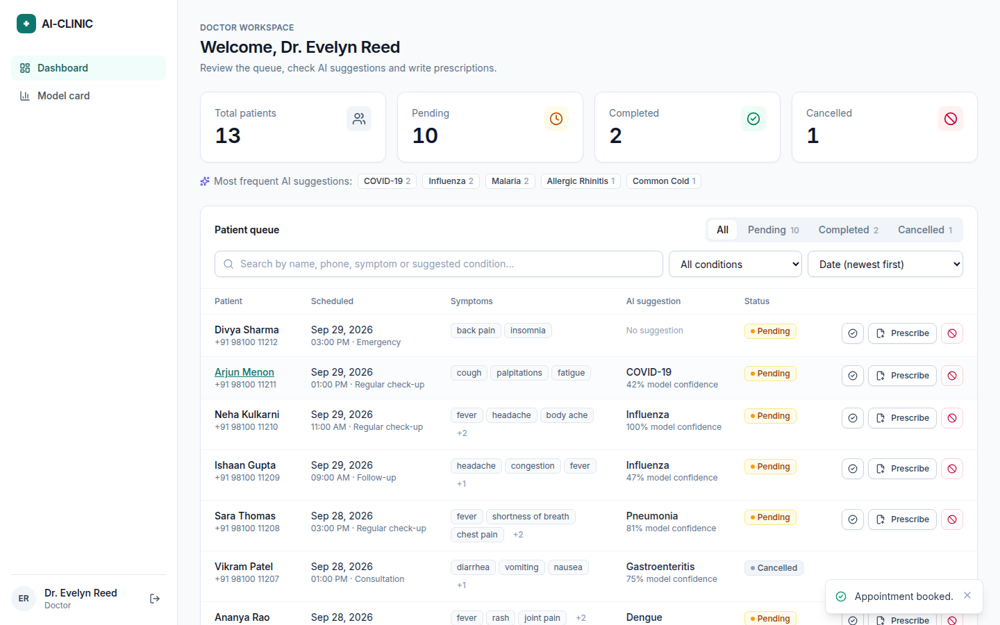
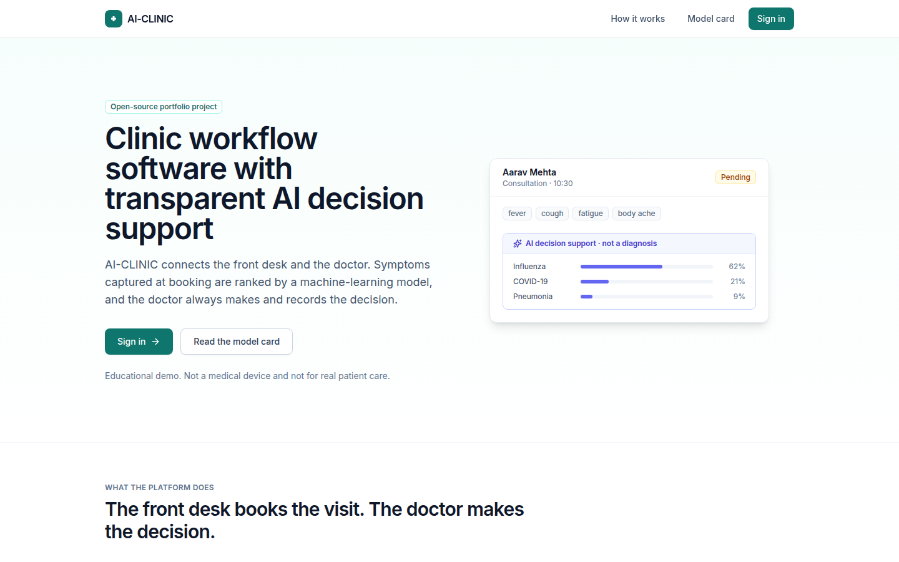
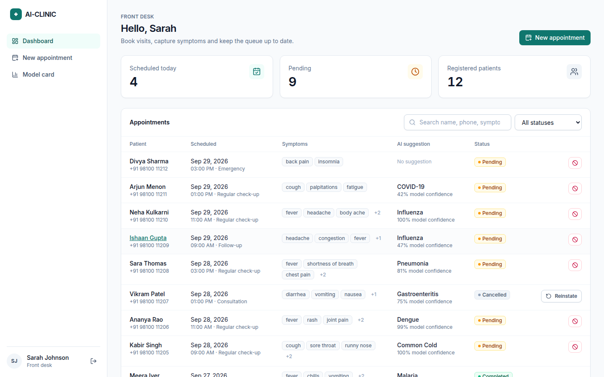
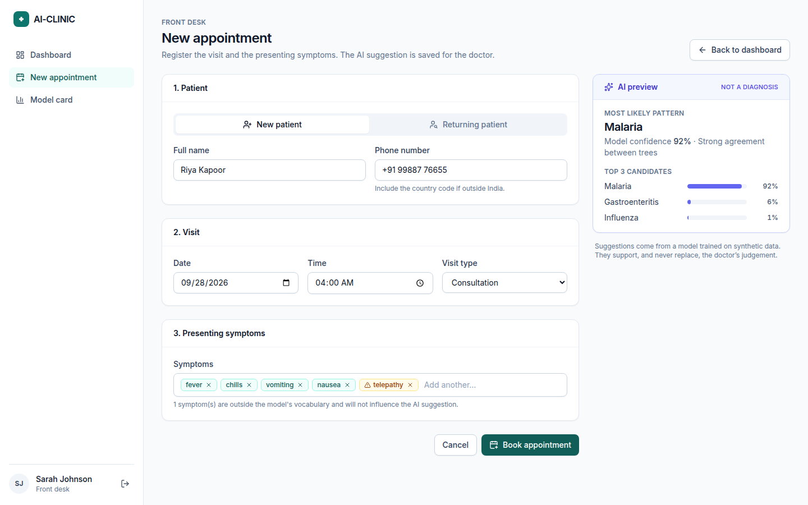
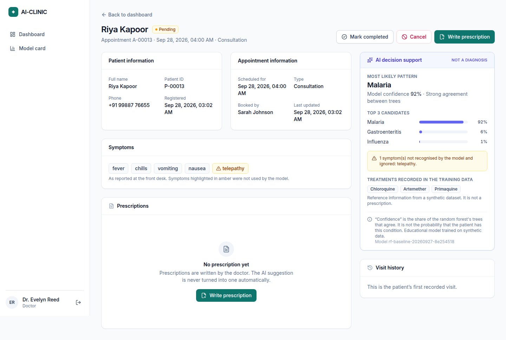
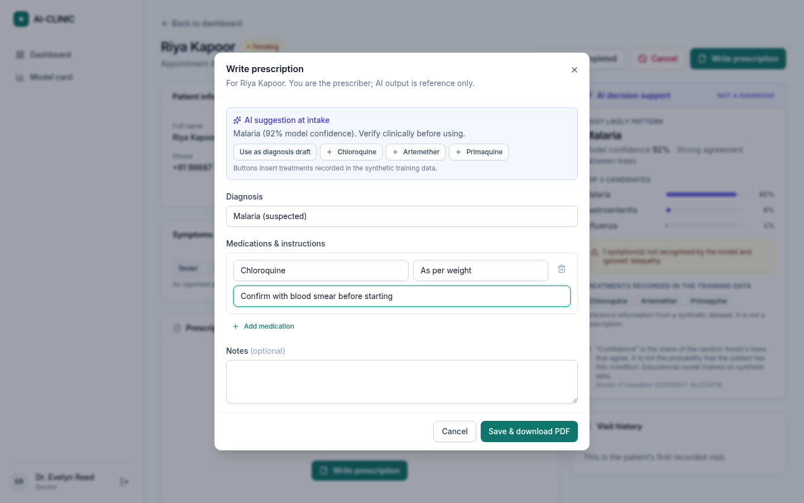
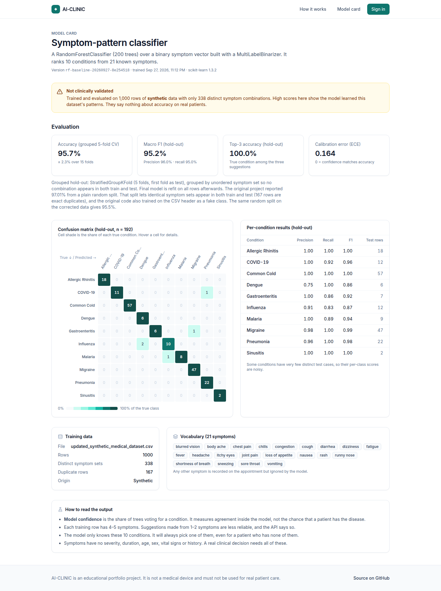
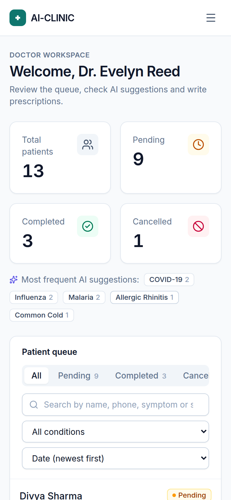

<div align="center">

# AI-CLINIC

**Clinic workflow software with transparent, machine-learning decision support**


[Features](#features) · [Architecture](#architecture) · [ML model](#machine-learning-model) · [Getting started](#getting-started) · [API](#api-reference) · [Docs](#documentation)



</div>

## Overview

AI-CLINIC connects a clinic's **front desk** and its **doctors** in one application. The front desk books visits and records presenting symptoms. At booking time, a **scikit-learn random forest** ranks the three most likely conditions and reports how strongly its trees agree. The doctor reviews the queue, makes the clinical decision, and writes a prescription that is exported as a **PDF**.

The system is a **React** single-page application backed by a **Flask REST API**, **JWT** authentication and **MongoDB Atlas**. All business rules, permissions and validation are enforced by the API.

> [!WARNING]
> **Educational project, not a medical device.** The model is trained on a small **synthetic** dataset and has **not been clinically validated**. Its output is decision support, not a diagnosis, and prescriptions are always written by a clinician. Do not enter real patient data.

### Highlights

- **Decision support, not diagnosis.** Predictions are shown as a ranked top 3 with *model confidence* (tree agreement), visually separated from clinician-authored data, and never inserted into a prescription automatically.
- **Honest evaluation.** A data-loading bug and duplicate-row leakage inflated the original 97.01% accuracy claim. Both were fixed, and the model is now evaluated with grouped cross-validation: **95.67% ± 2.33%**.
- **Production-style engineering.** Application factory, service layer, server-side validation with per-field errors, consistent JSON errors, structured logging without patient data, atomic IDs, concurrency guards and graceful degradation when the model or database is unavailable.

## Features

| Area | Capabilities |
| --- | --- |
| **Roles** | Separate front desk and doctor workspaces. Permissions are enforced by the API: only the front desk books; only doctors complete visits and prescribe. |
| **Front desk** | Today's and pending counts, searchable and filterable appointment list, cancel and reinstate. |
| **Booking** | New or returning patients (typeahead by name or phone), date, time and visit type, symptom chips with autocomplete from the model vocabulary, unknown symptoms flagged, live AI preview. |
| **Doctor** | Total, pending, completed and cancelled counts; most frequent AI suggestions; patient queue with search, status tabs, condition filter, sorting and pagination, all stored in the URL. |
| **Patient record** | Patient and appointment details, symptoms, top-3 AI suggestion with warnings, dataset reference treatments, prescriptions and visit history. |
| **Prescriptions** | Doctor-authored diagnosis, medications and notes. AI and dataset hints are inserted only by an explicit click. Exported as a PDF (ReportLab) with the AI note kept separate. |
| **Model card** | Public page with grouped cross-validation metrics, per-class results and a confusion matrix. |
| **Platform** | REST API with JWT auth, MongoDB persistence with indexes and audit timestamps, health check, 80 pytest and 19 Vitest tests. |

## Screenshots

| | |
| --- | --- |
| **Landing page**<br> | **Front desk dashboard**<br> |
| **New appointment with live AI preview**<br> | **Doctor dashboard**<br> |
| **Appointment details**<br> | **Doctor-authored prescription**<br> |
| **Model card**<br> | **Mobile**<br> |

## Architecture

```
          React SPA (Vite, Tailwind, React Router, TanStack Query)
                              │
                     HTTP/JSON + JWT bearer token
                              │
                  Flask REST API  (blueprints: routes/)
                              │
            validators ── services (business rules) ── auth
                              │
        ┌─────────────────────┼──────────────────────┐
        │                     │                      │
   PyMongo documents     ML predictor           PDF service
   MongoDB (Atlas)       scikit-learn           ReportLab
                         (loaded once)
                              ▲
             offline: scripts/train_model.py → models/*.joblib
```

Flask does not render pages; the React app is a separate static site that calls the API. The request lifecycle, data model and the reasoning behind each design decision are documented in [docs/ARCHITECTURE.md](docs/ARCHITECTURE.md).

### Tech stack

| Layer | Technology |
| --- | --- |
| Frontend | React 19, Vite, Tailwind CSS 4, React Router, TanStack Query, lucide-react |
| Backend | Python 3.11, Flask 3 (application factory + blueprints), PyJWT, flask-cors |
| Database | MongoDB (Atlas or self-hosted) via PyMongo, Stable API v1 |
| Machine learning | scikit-learn `RandomForestClassifier` + `MultiLabelBinarizer`, pandas, joblib |
| Documents | ReportLab (Platypus) |
| Testing | pytest, pypdf, mongomock · Vitest, Testing Library, jsdom |

### End-to-end flow

```
Front desk enters: Riya Kapoor · +91 99887 76655 · consultation · fever, chills, vomit, nausea, telepathy
   │
   ▼  POST /api/appointments   (JWT, role = frontdesk)
Validation         name/phone/date/type/symptoms checked; "vomit" → "vomiting" (alias)
   │
   ▼
ML preprocessing   known: fever, chills, vomiting, nausea · unknown: telepathy (ignored, flagged)
   │               → 21-dim 0/1 vector
   ▼
RandomForest       200 trees vote → Malaria 0.92 · Gastroenteritis 0.06 · Influenza 0.01
   │
   ▼
MongoDB            patients doc + appointments doc (status=pending, prediction embedded, model_version=rf-…)
   │
   ▼
Doctor dashboard   queue row "Riya Kapoor · Malaria · 92% model confidence"
   │
   ▼
Doctor             reviews, writes "Malaria (suspected)" + medications → POST /api/prescriptions
   │
   ▼
PDF                GET /api/prescriptions/3/pdf → prescription_RX-000003.pdf
```

## Machine learning model

| | |
| --- | --- |
| Algorithm | `RandomForestClassifier(n_estimators=200, random_state=42)` |
| Features | 21 binary symptom indicators from a `MultiLabelBinarizer` |
| Classes | 10 conditions: Allergic Rhinitis, COVID-19, Common Cold, Dengue, Gastroenteritis, Influenza, Malaria, Migraine, Pneumonia, Sinusitis |
| Data | `data/updated_synthetic_medical_dataset.csv`: 1,000 **synthetic** rows, 338 distinct symptom combinations, 167 exact duplicates |
| Output | Top-3 conditions with a vote share ("model confidence"), plus warnings for unknown or too few symptoms |

**Evaluation.** Splits are grouped by symptom set, so identical combinations never appear in both training and test data.

| Protocol | Accuracy |
| --- | --- |
| Original figure (original code, random split) | 97.01%, inflated by duplicate leakage **and** a bug that trained on the CSV header as a fake class |
| **Grouped 5-fold CV × 3 seeds (headline)** | **95.67% ± 2.33%** (macro F1 93.4%) |
| Grouped hold-out (n = 192) | 97.40% accuracy · 95.15% macro F1 · 100% top-3 |

A tuned configuration was evaluated and **not adopted**: it gained 0.6 percentage points (within noise) at the cost of a worse log loss. "Model confidence" measures tree agreement and is not a clinical probability; on this data the model is under-confident (mean 0.81 against 97% accuracy). The full methodology, metrics, confusion matrix and limitations are in [docs/ML.md](docs/ML.md).

## Project structure

```
AI-CLINIC/
├── client/                         React SPA
│   ├── src/
│   │   ├── components/             AppointmentList, SymptomInput, PredictionCard, PrescriptionDialog, …
│   │   │   ├── layout/             AppShell, PublicLayout, ProtectedRoute, Logo
│   │   │   └── ui/                 Modal, States (loading/empty/error), StatusBadge, Field
│   │   ├── context/                AuthContext, ToastContext
│   │   ├── hooks/                  queries.js (TanStack Query), useStatusChange, useDebouncedValue
│   │   ├── lib/                    api.js, format.js, constants.js, symptoms.js
│   │   ├── pages/                  Home, Login, FrontDesk, NewAppointment, DoctorDashboard,
│   │   │                           AppointmentDetails, ModelInfo, NotFound
│   │   ├── test/                   Vitest tests
│   │   └── App.jsx · main.jsx · index.css
│   └── .env.example · package.json · vite.config.js
│
├── server/                         Flask REST API
│   ├── app/
│   │   ├── __init__.py             create_app() factory
│   │   ├── config.py · extensions.py · errors.py · logging_config.py · auth.py · cli.py
│   │   ├── routes/                 health, auth, appointments, patients, predictions, prescriptions
│   │   ├── services/               appointment, patient, prediction, prescription, pdf
│   │   ├── models/                 user, patient, appointment, prediction, prescription
│   │   ├── ml/                     preprocessing, artifacts, predictor, training
│   │   └── utils/                  validators, responses
│   ├── scripts/                    train_model.py, evaluate_model.py
│   ├── tests/                      pytest suites
│   └── requirements.txt · requirements-dev.txt · pytest.ini · wsgi.py
│
├── data/                           updated_synthetic_medical_dataset.csv
├── models/                         disease_model.joblib, mlb.joblib, model_metadata.json
├── docs/                           ARCHITECTURE.md, ML.md, API.md, screenshots/
└── .gitignore · README.md
```

## Getting started

### Prerequisites

- **Python 3.10–3.12**
- **Node.js 22.22+** (or 24+; required by React Router 8 and Vitest)
- A **MongoDB** database: a free [MongoDB Atlas](https://www.mongodb.com/atlas) cluster or a local `mongod`

**Atlas setup (once):** create a database user under *Database Access*, allow your IP under *Network Access*, and copy the connection string from *Connect → Drivers*. If your IP is not allowed, connections time out and `/api/health` reports `"database": "unavailable"`.

### 1. Configure the environment

Create a `.env` file in the repository root. It is git-ignored and must never be committed.

```dotenv
APP_ENV=development
# At least 32 random characters: python -c "import secrets; print(secrets.token_urlsafe(48))"
JWT_SECRET=<random-secret>
JWT_EXPIRES_MINUTES=480

# mongodb+srv://<user>:<password>@<cluster>.mongodb.net/?retryWrites=true&w=majority  or  mongodb://localhost:27017
MONGODB_URI=<your-connection-string>
MONGODB_DB=ai_clinic

MODEL_DIR=models
DATASET_PATH=data/updated_synthetic_medical_dataset.csv
CORS_ORIGINS=http://localhost:5173
CLINIC_NAME=AI-CLINIC Demo Clinic
CLINIC_ADDRESS=For demonstration purposes only
LOG_LEVEL=INFO
LOG_FORMAT=text

# Used only by `flask seed-demo` to create doctor1 and frontdesk1 (8+ characters each)
DEMO_DOCTOR_PASSWORD=<password>
DEMO_FRONTDESK_PASSWORD=<password>
```

### 2. Install

```bash
git clone https://github.com/Shoaib1M/AI-CLINIC.git
cd AI-CLINIC

# Backend
cd server
python -m venv .venv
source .venv/bin/activate            # Windows: .venv\Scripts\activate
pip install -r requirements-dev.txt  # requirements.txt alone for production
flask --app wsgi seed-demo --with-appointments   # indexes, demo accounts and sample visits

# Frontend
cd ../client
npm install
```

The trained model is committed in `models/`, so no training is required to run the application.

### 3. Run

Use two terminals:

```bash
# Terminal 1 — API on http://127.0.0.1:5000
cd server && source .venv/bin/activate
flask --app wsgi run --debug

# Terminal 2 — React app on http://localhost:5173
cd client
npm run dev
```

Open http://localhost:5173 and sign in as `doctor1` or `frontdesk1` with the passwords from your `.env` (the sign-in page also lists the demo accounts). Check the API with `curl http://127.0.0.1:5000/api/health`.

To add real staff accounts (the password is prompted and stored only as a hash):

```bash
cd server
flask --app wsgi create-user drsmith --role doctor --full-name "Dr. Jane Smith"
```

### Environment variables

The API reads `.env` at the repository root; real environment variables take precedence.

| Variable | Default | Purpose |
| --- | --- | --- |
| `APP_ENV` | `development` | `development`, `production` or `testing` |
| `JWT_SECRET` | *(none)* | Token signing key, ≥ 32 characters. **Required in production.** In development a random key is generated per run, so sessions end on restart. |
| `JWT_EXPIRES_MINUTES` | `480` | Token lifetime |
| `MONGODB_URI` | *(none)* | **Required.** MongoDB connection string. Keep it in `.env`; never commit it. |
| `MONGODB_DB` | `ai_clinic` | Database name (created on first write) |
| `MONGODB_TIMEOUT_MS` | `5000` | Wait time before answering `503 DATABASE_UNAVAILABLE` |
| `MODEL_DIR` | `models` | Model artifact directory |
| `DATASET_PATH` | `data/updated_synthetic_medical_dataset.csv` | Training data |
| `CORS_ORIGINS` | `http://localhost:5173` | Comma-separated browser origins allowed to call the API |
| `CLINIC_NAME`, `CLINIC_ADDRESS` | demo values | Printed on PDFs |
| `LOG_LEVEL`, `LOG_FORMAT` | `INFO`, `text` | `LOG_FORMAT=json` emits one JSON object per line |
| `DEMO_DOCTOR_PASSWORD`, `DEMO_FRONTDESK_PASSWORD` | *(none)* | Used only by `flask seed-demo` |

Client (`client/.env`, optional): `VITE_API_URL`. Leave it empty locally (Vite proxies `/api` to Flask); in production set it to the API's public URL.

## API reference

Full reference with request/response examples and error codes: **[docs/API.md](docs/API.md)**.

| Method | Endpoint | Auth | Purpose |
| --- | --- | --- | --- |
| GET | `/api/health` | public | Liveness/readiness (database + model) |
| POST | `/api/auth/login` | public | Credentials → JWT |
| GET | `/api/auth/me` | any | Current user |
| GET | `/api/appointments` | doctor, frontdesk | Search, filter, sort and paginate |
| POST | `/api/appointments` | frontdesk | Book and store the AI suggestion |
| GET | `/api/appointments/stats` | doctor, frontdesk | Dashboard counts |
| GET | `/api/appointments/:id` | doctor, frontdesk | Full record and visit history |
| PATCH | `/api/appointments/:id` | doctor, frontdesk | Status (validated transitions), reschedule |
| GET | `/api/patients?q=` | doctor, frontdesk | Returning-patient typeahead |
| POST | `/api/predictions` | doctor, frontdesk | Stateless top-k prediction |
| GET | `/api/model` | public | Model card: vocabulary, classes, metrics |
| POST | `/api/prescriptions` | doctor | Doctor-authored prescription |
| GET | `/api/prescriptions/:id` | doctor, frontdesk | Read a prescription |
| GET | `/api/prescriptions/:id/pdf` | doctor, frontdesk | Download the PDF |

Success responses use `{"data": …, "meta"?: …}`; errors use `{"error": {"code", "message", "details"?}}`.

## Model training

Training is an explicit offline step; the web application only loads artifacts and never retrains.

```bash
cd server
python -m scripts.train_model                 # train, evaluate and write models/ (≈10 s)
python -m scripts.train_model --config tuned  # alternative hyper-parameters
python -m scripts.evaluate_model              # metrics, per-class results, confusion matrix, protocol comparison
python -m scripts.evaluate_model --compare    # grouped CV for every configuration
```

Restart the API after retraining. `model_metadata.json` records the version, dataset hash and all metrics, and `evaluate_model` warns if the CSV has changed since training. scikit-learn is pinned because pickled models are tied to the version that created them.

## Testing

```bash
cd server && pytest     # 79 tests on an in-memory MongoDB emulator (1 integration test skipped)
cd client && npm test   # 19 tests: login and route guards, API client, symptom input, booking flow, prediction card
```

Backend tests use **mongomock** by default, so they need no database or network. To run the full suite against a real MongoDB server (each test uses a throwaway `ai_clinic_test_*` database that is dropped afterwards), set `TEST_MONGODB_URI`. This also enables the integration test, which checks persistence across an application restart:

```bash
cd server && TEST_MONGODB_URI="mongodb+srv://<user>:<password>@<cluster>.mongodb.net/" pytest   # 80 tests
```

## Deployment

The API and the client deploy independently.

**API** — any Python host (Render, Railway, Fly.io or a VM):

```bash
cd server
pip install -r requirements.txt
APP_ENV=production JWT_SECRET=<48+ random chars> MONGODB_URI=<your connection string> \
  CORS_ORIGINS=https://your-frontend.example gunicorn -w 2 -b 0.0.0.0:$PORT wsgi:app
```

- With `APP_ENV=production` the app refuses to start without a strong `JWT_SECRET`, and debug mode is off.
- Use `LOG_FORMAT=json` for log aggregation and point the platform's health check at `/api/health`.
- Store `MONGODB_URI` as a secret and allow the host's outbound IPs in Atlas. The API is stateless, so multiple instances can share the cluster.
- Create accounts on the server with `flask --app wsgi create-user …`.
- Each gunicorn worker loads the model (~1 MB) once at startup.

**Client** — any static host (Netlify, Vercel, Cloudflare Pages or S3):

```bash
cd client
VITE_API_URL=https://your-api.example npm run build   # outputs client/dist/
```

Serve `index.html` for unknown paths (SPA fallback), add the client's origin to the API's `CORS_ORIGINS`, and serve both over HTTPS.

## Limitations

- **Synthetic data, not clinically validated.** 1,000 rows with 338 distinct combinations of 21 symptoms; the metrics describe this dataset, not real patients.
- **Decision support only.** The model always selects one of 10 conditions, has no "none of these" or urgency output, and ignores severity, duration, demographics, vital signs and history.
- **Model confidence is not a probability of disease.** It measures tree agreement and is not calibrated.
- **Reference treatments** come from the dataset (5 of 10 conditions have none) and are never used as prescriptions automatically.
- **Authentication scope.** JWT stored in `localStorage`, with no refresh tokens, login rate limiting, password reset or MFA.
- **Persistence.** No MongoDB schema validation or migrations; document shapes are enforced by the API's validators. Multi-document writes are not wrapped in transactions.
- **Single clinic, no doctor assignment.** All doctors share one queue.
- **Not compliant with health-data regulations** (HIPAA, GDPR, DPDP): no encryption at rest, audit-trail UI, consent or data-retention policy.

## Roadmap

- MongoDB JSON-schema validators per collection and transactions for multi-document writes
- HttpOnly cookie sessions with CSRF protection, refresh tokens and login rate limiting
- Doctor assignment and a calendar view with slot-conflict detection (`409`)
- Recording the doctor's final diagnosis to measure model agreement over time
- A real, de-identified dataset, calibrated probabilities and an explicit "uncertain / refer" output
- Audit log view
- Docker and docker-compose, and CI (GitHub Actions) running both test suites
- Playwright end-to-end tests

## Documentation

| Document | Contents |
| --- | --- |
| [docs/ARCHITECTURE.md](docs/ARCHITECTURE.md) | Request lifecycle, data model, design decisions and cross-cutting concerns |
| [docs/ML.md](docs/ML.md) | Dataset, preprocessing, model, evaluation methodology, results and limitations |
| [docs/API.md](docs/API.md) | Every endpoint with request/response examples and error codes |

## License

No license file is included, so all rights are reserved by the author by default. Add a `LICENSE` file (for example, MIT) to allow reuse.
